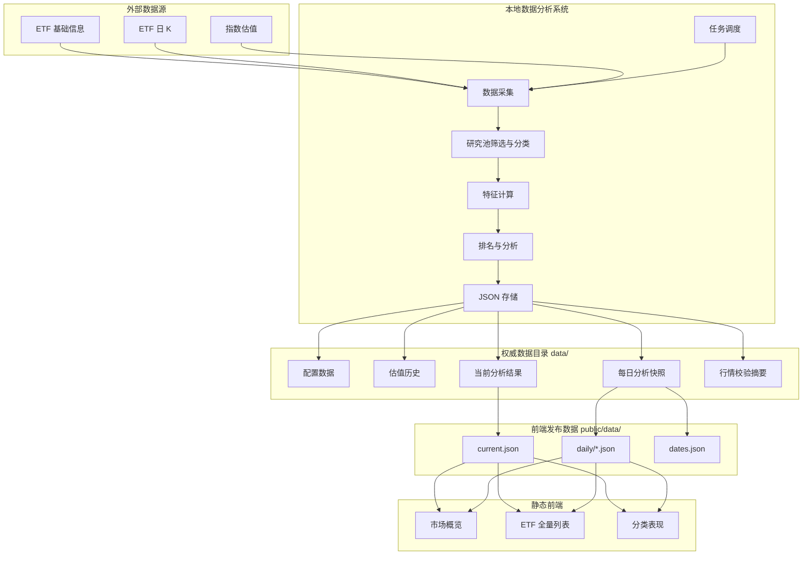
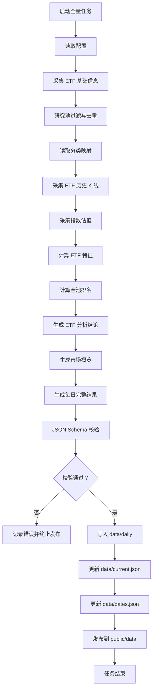
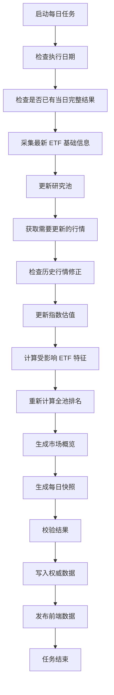
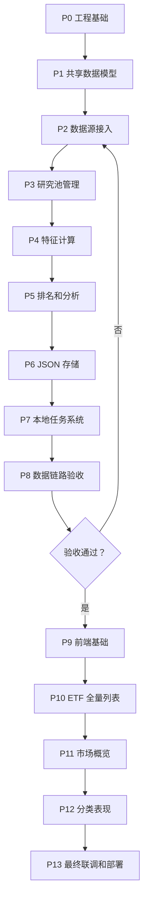

# ARCHITECTURE.md

# ETF 分析系统技术架构设计

**版本：** V0.6  
**文档类型：** 技术架构设计  
**适用对象：** Codex

---

## 1. 架构目标

构建一个以 ETF 数据采集、特征计算和分析结果生成为核心的本地数据分析系统。

系统分为两个相互独立的部分：

1. **数据分析系统**：使用 Node.js + TypeScript 运行，负责数据采集、计算、排名、分析和 JSON 生成。
2. **前端展示系统**：使用 Vite + React + TypeScript 构建，负责读取 JSON 并展示分析结果。

两部分通过 JSON 文件进行数据交互，不建设业务 API 服务。

### 1.1 核心架构原则

- 数据生产与数据展示分离。
- 数据任务可以独立运行。
- 前端不参与核心指标计算。
- JSON 是数据交互和结果存储格式。
- `data/` 是唯一权威数据目录。
- `public/data/` 是前端静态发布副本。
- 前端开发安排在数据链路验收之后。
- 不引入数据库和常驻业务服务。

## 2. 技术选型

| 层级         | 技术             | 职责                 |
| ------------ | ---------------- | -------------------- |
| 前端框架     | React            | 页面组件             |
| 前端构建     | Vite             | 开发和静态构建       |
| 编程语言     | TypeScript       | 前后端统一语言       |
| UI           | Tailwind CSS v4  | 样式                 |
| 组件库       | shadcn/ui        | 基础组件             |
| 图表         | ECharts          | 数据可视化           |
| 数据任务     | Node.js          | 本地任务运行         |
| 数据任务语言 | TypeScript       | 采集和计算           |
| 数据存储     | JSON             | 配置、估值和分析结果 |
| 任务调度     | 操作系统定时任务 | 定时执行             |
| 测试         | Vitest           | 单元和集成测试       |

### 2.1 明确不使用的技术

- Next.js
- Prisma
- SQLite
- MySQL
- PostgreSQL
- Redis
- Docker
- 消息队列
- 常驻业务 API 服务

不为当前规模引入不必要的基础设施。

## 3. 系统整体结构



前端和数据任务之间不存在运行时 API 调用，唯一交互方式是 JSON 文件。

## 4. 项目目录

```text
etf-analysis/
├── docs/
│   ├── PRODUCT.md
│   ├── ARCHITECTURE.md
│   ├── DATA-SOURCE.md
│   ├── RESEARCH-POOL.md
│   ├── DATA-MODEL.md
│   ├── CALCULATION-ENGINE.md
│   ├── RANKING-AND-ANALYSIS.md
│   ├── FRONTEND.md
│   ├── DEVELOPMENT-PLAN.md
│   └── decisions/
│       └── DECISIONS.md
│
├── src/
│   ├── app/
│   ├── components/
│   ├── features/
│   ├── lib/
│   └── types/
│
├── src-server/
│   ├── config/
│   ├── data-sources/
│   │   ├── etf/
│   │   ├── kline/
│   │   └── valuation/
│   ├── research-pool/
│   ├── calculations/
│   ├── ranking/
│   ├── analysis/
│   ├── storage/
│   ├── validation/
│   ├── publishing/
│   └── tasks/
│
├── shared/
│   ├── types/
│   ├── schemas/
│   └── constants/
│
├── scripts/
│   ├── full.ts
│   ├── daily.ts
│   ├── validate.ts
│   ├── recalculate.ts
│   └── publish.ts
│
├── data/
│   ├── config/
│   │   ├── categories.json
│   │   ├── etf-category-mapping.json
│   │   └── etf-universe.json
│   │
│   ├── valuation/
│   │   └── {indexCode}.json
│   │
│   ├── daily/
│   │   └── {YYYYMMDD}.json
│   │
│   ├── current.json
│   │
│   ├── dates.json
│   │
│   ├── kline-checksums/
│   │   └── {etfCode}.json
│   │
│   ├── backups/
│   └── logs/
│
├── public/
│   └── data/
│       ├── current.json
│       ├── dates.json
│       └── daily/
│           └── {YYYYMMDD}.json
│
├── package.json
├── tsconfig.json
├── vite.config.ts
└── ...
```

### 4.1 目录职责

| 目录           | 职责                          |
| -------------- | ----------------------------- |
| `src/`         | 前端代码                      |
| `src-server/`  | Node.js 数据任务业务代码      |
| `shared/`      | 前后端共享类型、Schema 和常量 |
| `scripts/`     | 数据任务命令入口              |
| `data/`        | 唯一权威业务数据目录          |
| `public/data/` | 前端静态数据发布目录          |
| `docs/`        | 产品和技术文档                |

### 4.2 唯一权威数据目录

`data/` 是所有数据任务读写的唯一权威目录。

以下数据只能以 `data/` 中的内容为准：

- ETF 研究池配置。
- ETF 分类配置。
- 指数估值历史。
- 每日分析快照。
- 当前分析结果。
- 历史日期索引。
- K 线校验摘要。
- 备份和任务日志。

禁止数据任务直接把 `public/data/` 当作权威存储目录。

### 4.3 前端发布目录

`public/data/` 是数据发布副本。

数据任务完成计算、校验和权威数据写入后，执行发布步骤：

```text
data/current.json
    -> public/data/current.json

data/dates.json
    -> public/data/dates.json

data/daily/*.json
    -> public/data/daily/*.json
```

只发布前端需要的数据，不发布：

- 上游原始响应。
- 任务日志。
- 行情校验摘要。
- 内部配置和备份。
- 不需要前端访问的估值原始历史文件。

发布过程必须保证文件内容与权威数据一致。

前端构建时，Vite 会将 `public/data/` 中的数据复制到 `dist/data/`。

### 4.4 数据目录配置

数据任务必须通过统一的路径配置模块获取目录，不允许在业务代码中散落硬编码路径。

支持通过环境变量指定数据根目录，默认使用项目根目录下的 `data/`。

前端发布目录默认使用项目根目录下的 `public/data/`。

开发环境和生产任务环境必须遵循相同的数据目录规则。

## 5. 数据生产系统

数据生产系统是整个项目的核心，不依赖前端。

### 5.1 模块职责

#### 数据源模块

负责：

- 请求 ETF 基础信息。
- 请求 ETF 日 K。
- 请求指数估值。
- 响应结构解析。
- 字段标准化。
- 数据质量检查。
- 请求超时和重试。

不负责研究池筛选和指标计算。

#### 研究池模块

负责：

- ETF 过滤。
- ETF 去重。
- 研究池更新。
- 分类映射。
- 自动分类建议。
- 待确认分类管理。
- 研究池变化记录。

不负责行情计算和排名。

#### 计算模块

负责：

- 收益率。
- 均线。
- BOLL。
- 波动率。
- 最大回撤。
- 成交额统计。
- 历史统计。
- 周 K 和月 K。
- 估值关联。

计算模块尽可能使用纯函数。

不直接请求网络，不直接写入文件。

#### 排名模块

负责：

- 动量排名。
- 风险排名。
- 成交活跃度排名。
- 溢价率排名。
- PE/PB/PS 排名。

排名结果使用统一共享类型。

不引入未经确认的综合评分。

#### 分析模块

负责：

- ETF 描述性结论。
- 趋势分析。
- 风险分析。
- 成交分析。
- 估值分析。
- 市场概览统计。

结论必须基于已有指标，不生成买卖建议。

#### 存储模块

负责：

- JSON 读取。
- JSON 写入。
- 原子写入。
- 历史快照管理。
- 当前结果更新。
- 历史日期索引维护。
- 估值历史 Upsert。
- 备份。

#### 发布模块

负责：

- 从权威数据目录读取发布数据。
- 生成或同步前端所需 JSON。
- 校验发布数据。
- 原子替换发布文件。
- 保证 `public/data/` 与 `data/` 中对应结果一致。

发布模块不负责重新计算指标。

## 6. 数据处理流程

### 6.1 全量计算流程



### 6.2 每日计算流程



### 6.3 历史修正流程

历史行情修正不能只重算当天。

流程：

1. 重新获取需要检查的历史 K 线。
2. 对比历史 K 线校验摘要。
3. 找到最早发生变化的日期。
4. 确定受影响 ETF。
5. 确定需要重算的日期范围。
6. 加载足够的历史前置行情。
7. 从最早受影响日期开始重新计算。
8. 更新受影响日期的 ETF 特征。
9. 更新受影响日期及之后的全池排名。
10. 更新受影响日期及之后的市场概览。
11. 更新对应历史快照。
12. 如果当前结果受影响，更新 `current.json`。
13. 更新 `dates.json`。
14. 重新发布受影响的前端数据文件。
15. 保存修正日志和备份。

#### 历史重算的前置数据

不能简单固定为 250 个交易日。

需要根据所有计算项目的最大历史窗口确定前置数据长度。

计算时应覆盖：

- 最大收益周期。
- 最大均线周期。
- 最大波动率窗口。
- 最大回撤窗口。
- 历史统计窗口。
- 周 K、月 K 聚合所需的日 K。
- BOLL 所需历史数据。

以所有实际计算窗口中的最大 lookback 为准。

前置数据用于保证计算正确，不意味着要覆盖或更新前置日期本身的分析结果。

#### 历史结果更新原则

假设最早受影响日期为 D：

- D 之前的分析结果保持不变。
- D 当天及之后受影响的结果重新计算。
- 更新对应的 `daily/{date}.json`。
- 如果当前结果受到影响，同步更新 `current.json`。
- 同步更新 `dates.json`。
- 不得只更新最新日期而保留错误的历史结果。

研究池当前变化不能直接覆盖历史快照中当时的 ETF 研究池和分类快照。

## 7. 数据模型和文件存储

具体字段以 `DATA-MODEL.md` 为准。

### 7.1 ETF 研究池配置

```text
data/config/
├── categories.json
├── etf-category-mapping.json
└── etf-universe.json
```

说明：

- `categories.json`：分类体系定义。
- `etf-category-mapping.json`：ETF 分类映射。
- `etf-universe.json`：当前研究池配置。

### 7.2 指数估值历史

```text
data/valuation/
├── {indexCode1}.json
├── {indexCode2}.json
└── ...
```

按指数代码拆分文件。

每条记录通过指数代码、估值日期和估值类型唯一确定。

同一指数的 PE、PB、PS 独立处理。

使用 Upsert 更新，不因上游某次未返回记录而删除已有历史数据。

### 7.3 每日分析快照

```text
data/
├── current.json
├── dates.json
└── daily/
    ├── 20261113.json
    ├── 20261114.json
    └── 20261115.json
```

#### current.json

保存当前最新的完整分析结果。

#### daily/{date}.json

保存指定交易日的完整分析结果。

每个历史快照必须自包含，包含当日研究池、分类快照、特征、排名、市场概览和任务信息。

不能依赖当前研究池重新拼装历史结果。

#### dates.json

保存可用历史分析日期索引。

用于前端历史日期选择。

具体结构以 `DATA-MODEL.md` 为准。

### 7.4 K 线校验摘要

```text
data/kline-checksums/
├── {etfCode1}.json
├── {etfCode2}.json
└── ...
```

用途：

- 记录已检查行情的摘要。
- 检测上游历史数据修正。
- 定位最早发生变化的日期。
- 避免每次无差别重算全部历史结果。

校验摘要不是原始 K 线数据，不用于替代行情采集。

### 7.5 K 线存储原则

当前系统不长期保存完整 K 线历史文件。

K 线数据在任务执行期间按需获取并在内存中使用。

需要持久化的是：

- 计算结果。
- 估值历史。
- 行情校验摘要。
- 每日分析快照。

当前 K 线数据模型不包含独立的 `KlineRaw` 表或文件存储。

## 8. JSON 写入与数据一致性

### 8.1 原子写入

所有重要 JSON 文件必须采用安全写入方式：

1. 先生成完整内容。
2. 写入临时文件。
3. 校验临时文件。
4. 使用文件重命名替换目标文件。

不能直接覆盖目标文件后再逐步写入内容。

### 8.2 每日快照写入顺序

推荐顺序：

1. 生成完整分析结果。
2. 校验 JSON Schema。
3. 写入 `data/daily/{date}.json`。
4. 更新 `data/current.json`。
5. 更新 `data/dates.json`。
6. 发布对应数据到 `public/data/`。

只有权威数据写入成功后才允许发布。

### 8.3 发布一致性

发布时：

- 不允许发布 Schema 校验失败的数据。
- 不允许只发布部分新数据而使前端读取到不一致的结果。
- 发布文件应使用临时文件和原子替换。
- 发布失败时保留原有可用发布文件。
- 发布任务可以单独重新执行。

如果发布中途失败，重新执行发布任务应能从 `data/` 恢复完整的发布副本。

## 9. 前端展示系统

### 9.1 前端定位

前端是独立的静态展示系统。

前端只负责：

- 加载 JSON。
- 展示数据。
- 动态筛选。
- 动态排序。
- 动态分类统计。
- 图表展示。
- 历史日期切换。

前端不负责：

- 数据采集。
- 研究池筛选。
- 特征计算。
- 全池排名计算。
- ETF 描述性结论生成。
- 市场概览结论生成。
- 数据持久化。

### 9.2 前端页面

仅有三个页面：

| 页面         | 主要职责                   |
| ------------ | -------------------------- |
| ETF 全量列表 | 展示整个研究池及排名       |
| 市场概览     | 展示市场统计和市场结论     |
| 分类表现     | 展示分类表现和分类内部统计 |

ETF 全量列表为默认首页。

不建设 ETF 详情页。

### 9.3 前端数据来源

前端统一从以下路径加载数据：

```text
/data/current.json
/data/dates.json
/data/daily/{date}.json
```

前端不得读取项目根目录下的 `data/`。

前端不得直接请求 ETF、K 线和估值上游接口。

### 9.4 分类动态统计

分类表现不单独保存分类分析结果。

前端从全池 ETF 数据中，根据分类映射动态过滤和统计。

分类筛选不得改变全池排名。

待确认分类不进入已确认分类的正式统计。

### 9.5 前端独立性

前端可以在没有数据采集服务运行的情况下正常访问已有 JSON。

数据任务可以在没有前端开发服务器运行的情况下独立完成。

前端构建只依赖共享类型、前端代码和 `public/data/` 中已发布的数据。

## 10. 前后端开发顺序与依赖

前端开发必须后置。

### 10.1 第一阶段：数据分析系统

先完成：

1. 工程基础。
2. 共享数据模型。
3. 数据源接入。
4. 研究池管理。
5. 特征计算。
6. 排名和分析。
7. JSON 存储。
8. 本地任务系统。
9. 数据链路验收。

在此阶段可以建立最小 Vite 工程，但不开发正式业务页面。

允许使用命令行、日志和测试程序验证数据结果。

### 10.2 第二阶段：前端展示系统

只有数据链路验收通过后才开始：

1. 前端基础。
2. ETF 全量列表。
3. 市场概览。
4. 分类表现。
5. 静态构建和部署。

### 10.3 阶段依赖关系



### 10.4 前端后置的验收要求

进入前端开发前，必须确认：

- 真实数据采集可用。
- 研究池结果正确。
- 核心计算结果经过验证。
- 全池排名结果正确。
- 市场概览数据完整。
- JSON Schema 全部通过。
- 每日快照可独立读取。
- 历史日期索引可用。
- 历史修正流程经过测试。
- 前端发布数据生成正常。

前端开发不得成为验证数据计算是否正确的手段。

## 11. 本地任务和调度

### 11.1 任务命令

最终支持：

```bash
pnpm task:full
pnpm task:daily
pnpm task:validate
pnpm task:recalculate
pnpm task:publish
```

命令职责：

| 命令               | 职责                         |
| ------------------ | ---------------------------- |
| `task:full`        | 全量采集、计算和结果生成     |
| `task:daily`       | 每日增量采集、计算和结果生成 |
| `task:validate`    | 检查数据完整性和计算结果     |
| `task:recalculate` | 历史数据修正和重算           |
| `task:publish`     | 将权威数据发布到前端目录     |

每个命令必须能够独立运行。

### 11.2 调度方式

使用操作系统定时任务：

- macOS：launchd 或 cron。
- Linux：cron 或 systemd timer。
- Windows：Task Scheduler。

不建设常驻任务调度服务。

### 11.3 任务并发控制

同一数据任务不允许并发执行。

使用本地锁文件：

- 任务开始时获取锁。
- 任务完成后释放锁。
- 检测到其他任务持有有效锁时退出。
- 异常退出后应能够识别并处理过期锁。

### 11.4 网络请求

统一请求配置：

- 默认超时时间：30 秒。
- 默认重试次数：3 次。
- 使用指数退避。
- 默认并发数：3。
- 单 ETF 失败不影响其他 ETF。
- 单估值类型失败不影响其他估值类型。

具体数据源可以在配置中覆盖默认值，但不得在业务模块中散落不同的请求策略。

### 11.5 任务日志

记录：

- 任务名称。
- 任务 ID。
- 开始时间。
- 结束时间。
- 执行状态。
- 处理 ETF 数量。
- 成功数量。
- 失败数量。
- 新增数据数量。
- 修正数据数量。
- 错误信息。

日志保存在 `data/logs/`。

## 12. 错误处理

### 12.1 数据源错误

包括：

- 网络请求失败。
- 超时。
- 返回结构变化。
- 字段缺失。
- 数值格式错误。
- 数据日期异常。

要求记录数据源、请求参数、错误原因和重试情况。

### 12.2 单 ETF 失败

单只 ETF 行情采集失败：

- 记录失败原因。
- 不影响其他 ETF。
- 不得使用错误数据覆盖已有有效结果。
- 当前结果需要明确反映数据完整性状态。

### 12.3 单估值类型失败

PE、PB、PS 独立处理。

其中一种类型失败不影响另外两种类型的数据采集和存储。

### 12.4 计算失败

单只 ETF 计算失败时：

- 记录 ETF code。
- 记录计算模块。
- 记录失败原因。
- 不得生成伪造的默认数值。
- 根据任务完整性规则标记结果状态。

### 12.5 发布失败

发布失败时：

- 不得破坏已有可用发布数据。
- 保留权威数据。
- 记录失败原因。
- 允许重新执行 `task:publish`。

## 13. 测试体系

### 13.1 单元测试

重点测试：

- ETF 过滤规则。
- ETF 去重规则。
- 分类映射。
- 收益率计算。
- 均线计算。
- BOLL 计算。
- 波动率计算。
- 最大回撤计算。
- 周 K、月 K 聚合。
- 历史统计。
- 排名规则。
- 估值百分位转换。
- JSON Schema。

### 13.2 集成测试

重点测试：

- ETF 数据采集和标准化。
- K 线采集和标准化。
- 估值采集和 Upsert。
- 研究池完整更新。
- 全量计算。
- 每日计算。
- JSON 快照生成。
- 历史结果修正。
- 前端数据发布。

### 13.3 端到端测试

使用固定测试数据：

1. 输入 ETF 原始数据。
2. 执行研究池筛选。
3. 输入 K 线和估值。
4. 执行完整计算。
5. 生成排名和分析结论。
6. 保存每日快照。
7. 执行 JSON 校验。
8. 执行发布。
9. 检查前端能够读取发布数据。

真实数据验收与固定测试数据验收需要分别记录，不能相互替代。

## 14. 性能与复杂度控制

当前研究池规模较小，优先保证计算口径和数据正确性。

不提前引入：

- 分布式计算。
- 多进程计算框架。
- 复杂任务队列。
- 数据库缓存。
- Redis。
- 常驻服务。
- 复杂数据仓库。

数据采集可以使用有限并发。

计算优先采用清晰、可测试的 TypeScript 函数。

如果未来实际数据规模显著增长，再根据性能测试决定是否优化。

## 15. 安全和数据保护

- 不在代码中硬编码密钥。
- 外部接口配置通过环境变量或本地配置文件管理。
- 不将敏感配置发布到 `public/data/`。
- 不将任务日志发布到前端目录。
- JSON 更新必须使用原子写入。
- 历史修正前保留必要备份。
- 不允许失败数据覆盖有效历史结果。

## 16. 最终架构验收标准

### 数据分析系统

- 可以独立运行全量任务。
- 可以独立运行每日任务。
- 可以独立执行历史修正。
- 可以生成完整每日分析结果。
- 可以查询历史分析结果。
- 可以校验 JSON。
- 可以将数据发布到前端目录。
- 不依赖前端服务。

### 前端展示系统

- 可以独立启动和构建。
- 可以读取 `current.json`。
- 可以读取历史日期数据。
- 可以展示 ETF 全量列表。
- 可以展示市场概览。
- 可以展示分类表现。
- 不直接访问上游数据源。
- 不依赖业务 API。

### 整体系统

- 数据任务和前端完全解耦。
- `data/` 是唯一权威数据源。
- `public/data/` 是可重新生成的发布副本。
- 前端在数据链路验收后开发。
- 最终通过静态方式部署。

**最终架构原则：先建设稳定、可独立运行的数据生产系统，再建设消费 JSON 的静态前端。**
